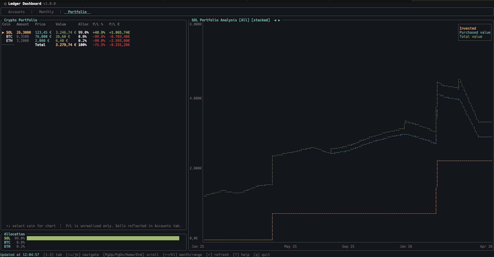
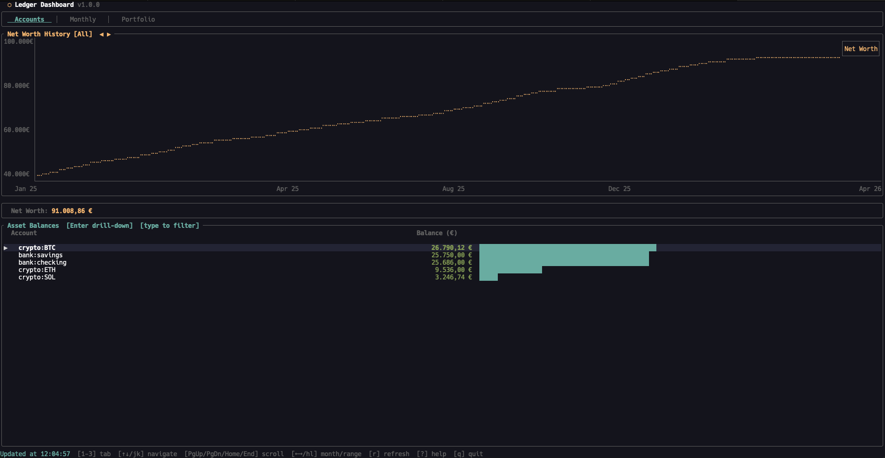
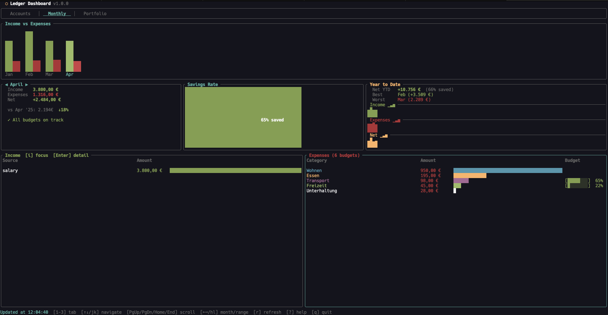

After months of evening commits, **ldash 1.0.0** is out.

ldash is a terminal dashboard for [hledger](https://hledger.org/). It turns my plain-text journal into a live overview of net worth, monthly spending, budgets, savings goals, and crypto portfolio — all keyboard-driven, all offline, no browser tab required.

If you live in the terminal and use hledger (or want to), this post is for you. New to the world of [Plain Text Accounting](https://plaintextaccounting.org/)? It is a small, friendly community built around the idea that your financial data should be a text file you fully own — and ldash is one window into that idea.

> Repo: [codeberg.org/md-weber/ldash](https://codeberg.org/md-weber/ldash)

## Why I built ldash

I track my finances in plain text with hledger. It is precise, scriptable, and mine forever. (If you are new to the space, hledger sits next to [ledger-cli](https://www.ledger-cli.org/) and [Beancount](https://beancount.github.io/) as one of the three mainstream plain-text accounting tools — ldash is built specifically for hledger.) But hledger is a CLI: every question (How much did I spend on groceries last month? What is my net worth trend? How is my crypto portfolio doing?) is a separate command with a separate set of flags.

For a long time I bounced between three patterns:

- a wall of `hledger bal`/`hledger reg` commands I had memorized
- a half-broken bash script that stitched several reports together
- shelling out to a web tool that needed exporting and uploading data I would rather keep on disk

None of it felt right. I wanted one place that answered the four questions I actually ask every week:

1. What is my net worth, and where is it trending?
2. How much did I spend this month, by category, vs my budget?
3. How is my crypto allocation performing — invested vs price gain vs staking?
4. Am I making progress on my savings goals?

ldash is the answer I built for myself.

## What you get in 1.0.0

ldash launches into three tabs you can switch with `1`, `2`, `3` (or `Tab`):

### Portfolio

- Holdings table with price, value, allocation %, and per-coin P/L
- Split between **invested**, **price gain**, and **staking rewards**, so you actually know where the gains came from
- Stacked or unstacked chart mode (`s` to toggle)
- Net worth history with selectable ranges: YTD / 1Y / 2Y / 5Y / All



### Accounts

- All asset accounts with EUR valuations and visual bar indicators
- Drill into any account to see its recent transactions (`Enter`)
- Savings goals with progress bars and target amounts



### Monthly

- Income and expenses bar chart with per-category breakdown
- Savings rate gauge
- Year-over-year comparison
- Budget tracking inline: progress bars per category, warnings when over budget
- Drill-down into any expense category



A few things that are easy to miss but matter every day:

- **Background refresh** — data loads in parallel, the UI never blocks
- **Auto-reload** — ldash watches your journal file and refreshes when it changes
- **Lazy tab loading** — only the active tab loads on first visit, so startup is instant
- **Hot-reload config** — change a color or budget, save the file, see it immediately

## Tech under the hood

- **Rust** + [Ratatui](https://ratatui.rs/) for the TUI (if you live in this corner, [Awesome Ratatui](https://github.com/ratatui/awesome-ratatui) is a great rabbit hole)
- **hledger** as the source of truth — ldash reads from your journal, never writes to it
- A separate `prices.journal` file holds crypto price history, so the portfolio view works fully offline
- CI on Codeberg builds release binaries for `x86_64`/`aarch64` Linux and macOS
- Tested with unit, snapshot, and integration suites

The whole thing is a single binary, ~3 MB, with no daemon and no database. Your data lives in your journal. ldash is just the lens you look through.

## Try it

You need [Rust 1.70+](https://rustup.rs/) and [hledger](https://hledger.org/install.html) installed. If hledger is brand new to you, the [official docs](https://hledger.org/) are the single best starting point.

```sh
git clone https://codeberg.org/md-weber/ldash.git
cd ldash
cargo install --path .
```

Then point it at a journal:

```sh
ldash /path/to/all.journal

# or
export LEDGER_FILE=/path/to/all.journal
ldash
```

If you keep an `all.journal` in your finance directory, you can also just `cd` there and run `ldash` with no arguments.

[AUR packaging](https://codeberg.org/md-weber/ldash/src/branch/main/packaging/aur) and a [Nix flake](https://codeberg.org/md-weber/ldash/src/branch/main/flake.nix) are in the repo. A Homebrew tap is planned for a `1.0.x` patch release.

## Configuration that stays out of your way

On first launch, ldash creates `~/.config/ldash/config.toml` with everything commented out. Sensible defaults take over until you decide otherwise.

You can:

- Set a default tab, refresh interval, and number format (`eu` / `us`)
- Define **monthly budgets** per expense category
- Define **savings goals** mapped to account prefixes
- Reassign category colors so your spending chart matches how your brain groups things
- Pick a theme — or paint your own (see below)

Saving the config triggers a hot-reload — no restart.

### Themes: three presets, fully customizable

ldash ships with three built-in themes:

- **`dark`** — the default. Dark background with a cyan accent.
- **`light`** — light background with a blue accent. Self-contained, so it works on any terminal.
- **`solarized`** — the classic Solarized Dark palette.



Pick one in `config.toml`:

```toml
[theme]
preset = "solarized"   # or "dark" (default) or "light"
```

Every color can also be **overridden individually**, with or without a preset. Want Solarized but with an orange accent? Mix and match:

```toml
[theme]
preset  = "solarized"
accent  = "#ff8800"   # override just the accent color
```

Available color fields (defaults shown for the `dark` preset):

| Field        | Default    | Role                                       |
|--------------|------------|--------------------------------------------|
| `accent`     | `cyan`     | Borders, highlights, selected tab          |
| `positive`   | `green`    | Income, gains, positive amounts            |
| `negative`   | `red`      | Expenses, losses, negative amounts         |
| `muted`      | `darkgray` | Secondary text, axis labels                |
| `gold`       | `yellow`   | Net worth line, titles, P/L totals         |
| `fg`         | `white`    | Primary text                               |
| `background` | `#14141e`  | Title bar, popup backgrounds               |

Color values accept named colors (`red`, `green`, `blue`, `yellow`, `cyan`, `magenta`, `white`, `gray`, `darkgray`) or hex codes (`#RRGGBB`). Theme changes hot-reload the moment you save the file — no restart needed.

### Example config

Here is a real-world `~/.config/ldash/config.toml` that uses most of what ldash offers:

```toml
# Path to hledger journal (overrides $LEDGER_FILE and CLI arg)
journal = "/home/max/Finance/all.journal"

# Auto-refresh interval in seconds
refresh_interval = 300

# Default tab on startup: "portfolio", "accounts", "monthly"
default_tab = "portfolio"

# Number format: "eu" (1.000,00) or "us" (1,000.00)
number_format = "eu"
currency_symbol = "€"

# Portfolio chart mode: "stacked" or "unstacked"
chart_mode = "stacked"

# Theme — solarized base, custom accent
[theme]
preset = "solarized"
accent = "#ff8800"
gold   = "#f5c518"

# Per-category expense colors
[colors.expenses]
Wohnen    = "blue"
Essen     = "yellow"
Transport = "#B48CFF"

# Monthly budgets per expense category
[budgets]
"expenses:Essen"     = 400.0
"expenses:Freizeit"  = 200.0
"expenses:Transport" = 150.0

# Savings goals (target amount + account prefix)
[[goals]]
name    = "Emergency Fund"
target  = 15000.0
account = "assets:bank:savings"

[[goals]]
name    = "New Laptop"
target  = 2500.0
account = "assets:bank:savings:laptop"
```

Drop in only the parts you care about — every section is optional and defaults fill the rest. A few annotated configs also live in the [`examples/`](https://codeberg.org/md-weber/ldash/src/branch/main/examples) directory of the repo.

## What 1.0.0 means to me

Solo development is a lot of small, invisible decisions. Naming a flag. Choosing a default. Deciding the tenth time whether a feature belongs in 1.0 or in 1.1.

For me, 1.0.0 means three things:

- The **core experience is real**: I use ldash daily for my own finances.
- The **foundation is stable**: tests, CI, release pipelines, packaging.
- The **scope is honest**: it does what it claims, nothing more, nothing fake.

Shipping 1.0.0 alone is a strange feeling. It is exciting, slightly anticlimactic, and motivating all at once. Now the interesting part starts: real users, real edge cases, real feedback.

## What is next

The roadmap I am most excited about:

- Homebrew tap (`brew install ldash`)
- More chart types and time ranges
- Smarter portfolio insights (rebalancing hints, cost basis views)
- Better keyboard onboarding for first-time hledger users
- Quality-of-life improvements driven by what people actually report

If you try ldash and something is missing, broken, or just feels off, please open an [issue on Codeberg](https://codeberg.org/md-weber/ldash/issues). The full [`CHANGELOG.md`](https://codeberg.org/md-weber/ldash/src/branch/main/CHANGELOG.md) lives in the repo if you want to track what is shipping. Issues from real users shape the roadmap more than anything I can plan in advance.

## Final note

I built ldash because I wanted a calmer way to look at my own money. Plain-text accounting gives you control. ldash gives you a window into it that does not get in your way.

If you are an hledger user — or you have been tempted to try plain-text accounting and were missing the dashboard piece — I would love to hear what you think.

I write about engineering, side projects, and the long road of becoming a software engineer over on this blog — if you are curious where ldash fits into a longer story, [my career path post](/posts/personal_dev_story/) is a good starting point.

### Stay in touch

If you want to follow what I am building next or support the work directly:

- ▶️ Flutter & dev videos on [YouTube — Flutter Explained](https://youtube.com/flutterexplained)
- ⚡ Find me on Nostr via [Primal](https://primal.net/p/nprofile1qqs2vxjufd5sqyfsfp7h8un4crd8nld5mt9e9sv59jcsxuw8kwctzwswn3er8)
- ❤️ Support indie work on [Patreon](https://patreon.com/dev_cafe)

Thanks for reading, and thanks for supporting independent builders.

> ⬡ [codeberg.org/md-weber/ldash](https://codeberg.org/md-weber/ldash) · [GPL-3.0-or-later](https://www.gnu.org/licenses/gpl-3.0.html) · built with Rust + [Ratatui](https://ratatui.rs/) · [screenshots](https://codeberg.org/md-weber/ldash/src/branch/main/screenshots)
